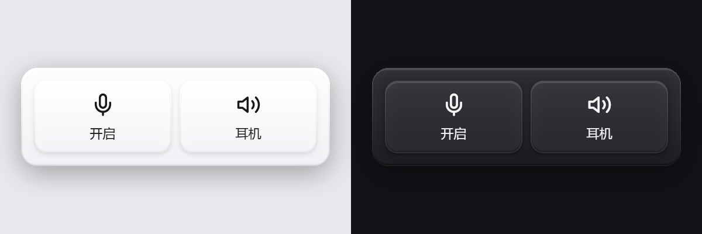

# quick-action

Windows 桌面上的一个小开关：一键闭麦，一键切换耳机 / 音响。



## 下载

Windows 64 位。到 [Releases](https://github.com/Kutius/quick-action/releases/latest) 下载安装包（`quick-action-setup-*-amd64.exe`），或者用免安装的 zip，解压后直接运行。

## 功能

- **闭麦** — 点击麦克风磁贴，静音或取消静音所有活动的录音设备
- **切换输出** — 点击输出磁贴，在上一次用过的设备之间互切；鼠标移上去后点右上角箭头，可以从完整列表里挑
- **托盘图标** — 左键显示 / 收起面板，右键菜单里还有静音、切换输出、退出
- **全局快捷键** — `Ctrl+Alt+M` 闭麦，`Ctrl+Alt+O` 切换输出
- **全屏游戏自动让位** — 有程序全屏时面板自己藏起来，退出后自己回来

## 从源码运行

需要 Go 1.27 和 [MyGo](https://mygo.egoist.dev)。

```sh
go run .
```

打包：

```sh
go tool mygo build
```

## 说明

- 目前只做了 Windows 的音频控制。macOS 和 Linux 需要在 `audio_other.go` 里补实现。
- 闭麦是**端点级静音**：静音的是设备本身，所以用另一支麦克风的应用同样听不到你。代价是会议软件里自己的「已静音」按钮不会跟着变。
- 纯 Go，无 cgo。Core Audio 通过 COM vtable 直接调用；切换默认输出用的是未公开的 `IPolicyConfig`。
- 面板的颜色和材质跟随系统的浅色 / 深色。

## 许可

MIT
